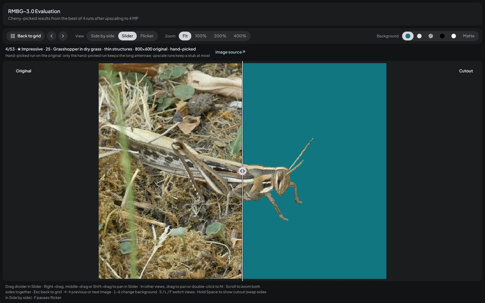

# RMBG-3.0 study: 53 hard background-removal cases

Bria's [RMBG-3.0](https://huggingface.co/briaai/RMBG-3.0) background-removal model, tested on hard cases.

#### **[Open the viewer →](https://novmikvis.github.io/RMBG-3.0-study/)**

The 53 images cover hair, lace, mesh, motion blur, smoke, clear glass, insect wings, poor lighting and subjects in crowds.

## How to use the viewer

* Scroll to zoom. Use **Background** to check the cutout on teal, checkerboard, stripes, black or white, or to see the raw matte.
* Press `←` or `→` to go to the previous or next image. Press `Esc` to return to the grid. Use `1`–`6` to change the background and `S` / `L` / `F` to switch views. Hold `Space` to show the cutout.

## Run settings

* **Images are cherry-picked from best of 4**
* Inference settings from the original repo: 4 steps, CFG 1, euler/simple.
* Base seed 424242, iterated to 424245 during generation. Input capped at 4 MP to speed up each run.
* Small source images upscaled to 4 MP with Qwen 2.1 turbo for a fair test.

## Findings

* Changing the seed made a much bigger difference to the matte edges than switching between int8 and bf16. Try a few seeds and pick the best result.
* Upscaling first gave sharper edges. It also led the model to fill in soft or transparent areas like motion-blurred wings, smoke, clear lenses, wing cells and thin antennae. In those cases, run the model on the original too.
* Different text in the prompt field had no effect on which object the model isolated. To keep one object, crop the image or combine the matte with a segmentation mask, or run more seeds.

## How to run it yourself

[Get the workflow here](workflow/RMBG-3.0%20Fibo2.json).

1. Use ComfyUI v0.43.0 or later. Built-in Fibo 2.0 support lets you run the workflow without custom nodes.
2. Download:
	- [rmbg3_int8_convrot.safetensors](https://huggingface.co/briaai/RMBG-3.0-Comfy/blob/main/diffusion_models/rmbg3_int8_convrot.safetensors) (8.41 GB) to `models/diffusion_models/`.
	- [qwen3vl_4b_int8_convrot.safetensors](https://huggingface.co/briaai/RMBG-3.0-Comfy/blob/main/text_encoders/qwen3vl_4b_int8_convrot.safetensors) (4.86 GB) to `models/text_encoders/`.
	- [flux2-vae.safetensors](https://huggingface.co/briaai/RMBG-3.0-Comfy/blob/main/vae/flux2-vae.safetensors) (336 MB) to `models/vae/`.
3. Bria recommends keeping the instruction text exactly as written. Load your image and run the workflow.

## Image Sources

* 42 from the bgsys [Background Removal Arena](https://huggingface.co/spaces/bgsys/background-removal-arena) datasets on Hugging Face.
* 11 from other sources.

The [sources page](https://novmikvis.github.io/RMBG-3.0-study/sources.html) links each image to its dataset row or original photo.

The test images belong to their owners and the listed datasets. They are shown here only to evaluate the model. RMBG-3.0 is licensed [CC BY-NC 4.0](https://huggingface.co/briaai/RMBG-3.0#%F0%9F%93%9C-license). Commercial use needs an agreement with Bria AI.

The viewer follows the [ComfyUI-Panorama-Stickers design guide](https://github.com/nomadoor/ComfyUI-Panorama-Stickers/blob/main/docs/design.md).

## License

The viewer code and workflow use the MIT license (see [LICENSE](LICENSE)). The test images belong to their original authors.
